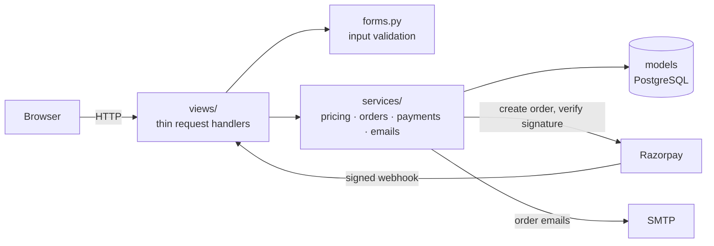

# 🌸 Bloomify — Online Flower Bouquet Ordering & Delivery

[](https://github.com/mantra1424/bloomify/actions/workflows/ci.yml)


A full-stack Django e-commerce app for a florist: customers browse and order bouquets
(or design their own), pay online with Razorpay or cash on delivery, pick a delivery slot
and track their order. Staff and admins run the shop from a role-based admin panel with
stock alerts, order management, coupons and sales reports.

**Live demo:** _add your Render URL here after deploying_ · **Demo logins:** [below](#demo-accounts)

---

## Features

**Customers**
- Browse by occasion, search with autocomplete, filter by price, sort by popularity
- Product reviews, wishlist, "you may also like" recommendations
- **Custom bouquet builder** — pick flowers, stem count, wrapping and a message card; priced on the server
- Cart with live stock limits, coupon codes, delivery slots (7-day window)
- Delivery fee by city, distance and speed (normal / same-day / midnight), free above ₹1,000
- **Razorpay** online payments (UPI, cards, netbanking) or cash on delivery
- Order tracking, cancellation (stock, coupon use and slot are given back), email confirmations
- Account dashboard, saved addresses, password reset by email

**Staff & admins** (`/admin-panel/`)
- Dashboard with revenue, order counts, low-stock and out-of-stock alerts, charts
- Order management with status workflow (Placed → Packed → Out for delivery → Delivered)
- Product and coupon management (admins only — staff see orders but cannot change the catalogue)
- Sales report with filters, CSV export and a print/PDF view
- Contact messages inbox; Django admin at `/django-admin/` for superusers

**Engineering**
- Business rules in a tested `services/` layer; thin views; Django forms validate every input
- Payment safety: signature-verified Razorpay callbacks **and** a signed webhook, amount checks,
  idempotent confirmation, unpaid orders auto-expire and release stock
- Concurrency-safe stock, coupon and slot booking (conditional updates inside transactions)
- Security: Django auth with email login, brute-force lockout (django-axes), password strength rules,
  CSRF on every form, open-redirect protection, CSV formula-injection guard, HTTPS/HSTS in production
- 146 automated tests (86% coverage), Ruff lint/format, GitHub Actions CI on PostgreSQL
- Docker image, docker-compose, one-click Render blueprint

## Tech stack

| Layer | Choice |
| --- | --- |
| Backend | Python 3.14, Django 6.1 |
| Database | PostgreSQL 17 (SQLite for quick local dev) |
| Payments | Razorpay (Orders API, checkout.js, webhooks) |
| Frontend | Django templates, vanilla JS, Chart.js |
| Serving | gunicorn + WhiteNoise; optional S3-compatible storage for uploads |
| Quality | pytest, pytest-django, coverage, Ruff, pre-commit, GitHub Actions |
| Ops | Docker, docker-compose, Render, Sentry (optional) |

## Architecture



More detail — request flow, payment lifecycle and data model — is in [docs/ARCHITECTURE.md](docs/ARCHITECTURE.md).

```
bloomapp/
├── models.py            # data model (User, Product, Order, Payment, …)
├── forms.py             # every user input is validated here
├── services/            # business rules — pricing, orders, payments, emails
├── views/               # one module per area; admin_panel/ for the back office
├── permissions.py       # staff / admin access decorators
├── templates/ static/   # UI
├── management/commands/ # seed_data, release_unpaid_orders
└── tests/               # pytest suite
bloomproject/settings/   # base · dev · prod · test
```

## Getting started

### Option A — Docker (closest to production)

```bash
docker compose up --build
```

Open http://localhost:8000. This runs PostgreSQL, applies migrations and loads demo data.

### Option B — Python virtual environment

```bash
python3 -m venv .venv && source .venv/bin/activate
pip install -r requirements-dev.txt
cp .env.example .env            # then edit values
python manage.py migrate
python manage.py seed_data      # demo users, products, coupons
python manage.py runserver
```

Emails are printed to the terminal unless SMTP settings are filled in `.env`.

### Demo accounts

Created by `python manage.py seed_data` (and on every Render deploy):

| Role | Email | Password | Can access |
| --- | --- | --- | --- |
| Customer | `demo@bloomify.com` | `demo123` | Shop, cart, checkout, dashboard |
| Staff | `staff@bloomify.com` | `staff123` | Admin panel: dashboard, orders, messages |
| Admin | `admin@bloomify.com` | `admin123` | Whole admin panel |

The seeded admin can't open `/django-admin/`; create a private superuser for that with
`python manage.py createsuperuser`. Change or remove the demo accounts before real use.

### Test payments

With Razorpay **test** keys in `.env`, choose *Pay Online* at checkout and use Razorpay's
[test card](https://razorpay.com/docs/payments/payments/test-card-details/) — for example
Mastercard `5267 3181 8797 5449`, any future expiry, any CVV, any OTP. No real money moves.

To receive webhooks locally, expose your server (e.g. with a tunnel), add
`https://<host>/payments/webhook/` in Razorpay Dashboard → Webhooks with the events
`payment.captured` and `payment.failed`, and put the webhook secret in `RAZORPAY_WEBHOOK_SECRET`.

## Tests and code quality

```bash
pytest                       # 146 tests
pytest --cov                 # with coverage report
ruff check . && ruff format --check .
pre-commit install           # run lint/format on every commit
```

CI (`.github/workflows/ci.yml`) runs lint, a missing-migration check, the tests on PostgreSQL
with an 80% coverage floor, and Django's production security check (`check --deploy`).

## Deploying to Render

1. Push this repository to GitHub.
2. In Render: **New → Blueprint**, pick the repo. `render.yaml` creates a free PostgreSQL
   database and web service; `DJANGO_SECRET_KEY` is generated for you.
3. Set `RAZORPAY_KEY_ID`, `RAZORPAY_SECRET_KEY` and (optionally) `RAZORPAY_WEBHOOK_SECRET`,
   `SENTRY_DSN`, `BLOOMIFY_EMAIL` / `BLOOMIFY_EMAIL_PASS` in the service's environment.
4. Deploy. Health check: `/healthz/`.

Notes for the free tier: the instance sleeps when idle (first request takes ~1 minute), and
uploaded images disappear on redeploy unless you configure S3-compatible storage with the
`AWS_*` variables in `.env.example`. Without SMTP settings, emails (including password-reset
links) are written to the service logs.

## Configuration

All settings come from environment variables (or a local `.env`) — see [.env.example](.env.example).
Settings modules: `bloomproject.settings.dev` (default for `manage.py`), `.prod` (default for
gunicorn/WSGI) and `.test` (pytest).

## License and credits

Built as an internship project. Product data in `seed_data` is fictional.

The demo product photos are free-licensed images from Wikimedia Commons (CC0, CC BY and CC BY-SA),
credited on the site at `/photo-credits/` and in [docs/PHOTO_CREDITS.md](docs/PHOTO_CREDITS.md).
