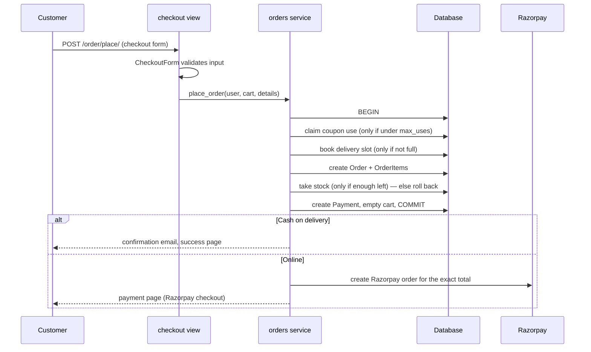
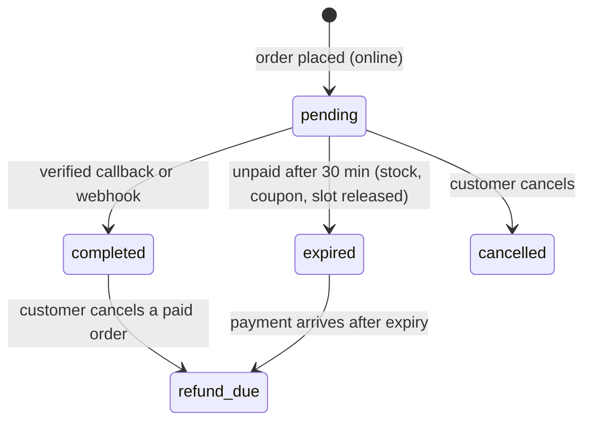
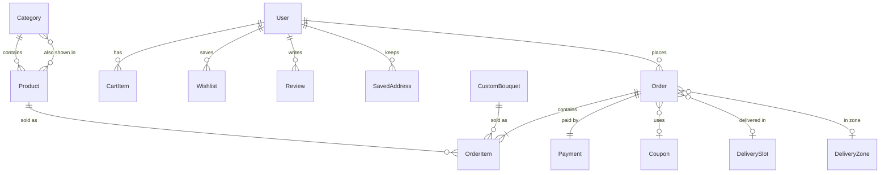

# Petal & Stem architecture

This document explains how the code is organised and how the important flows work.
For setup and running instructions see the [README](../README.md).

## Layers

| Layer | Where | Responsibility |
| --- | --- | --- |
| URLs | `bloomapp/urls.py` | Map paths to views |
| Views | `bloomapp/views/` | Read the request, call forms/services, render a response. No business rules. |
| Forms | `bloomapp/forms.py` | Validate and clean all user input (checkout, signup, profile, products, coupons…) |
| Services | `bloomapp/services/` | Business rules: prices, orders, payments, emails |
| Permissions | `bloomapp/permissions.py` | `staff_required`, `admin_role_required` for the admin panel |
| Models | `bloomapp/models.py` | Data and small derived properties |

Views are grouped by area: `pages`, `accounts`, `catalog`, `cart`, `checkout`, `payments`,
`orders`, and `admin_panel/` (`auth`, `dashboard`, `catalog`, `orders`, `reports`).

## Users and roles

`User` extends Django's `AbstractUser` and logs in with **email** (no username).

| `role` | Shop | Admin panel |
| --- | --- | --- |
| `user` | ✅ | ❌ |
| `staff` | ✅ | Dashboard, orders, messages, product list (read-only) |
| `admin` | ✅ | Everything, including products, coupons, users and sales reports |

`is_staff` / `is_superuser` are separate and only control the built-in Django admin at `/django-admin/`.

Login protection: passwords are hashed by Django; `django-axes` locks an email + IP pair for
1 hour after 5 failed attempts; login only follows `?next=` links on this site; logout is POST-only.

## Pricing (`services/pricing.py`)

`pricing.py` is the single source of truth for prices and the list of cities we deliver to.
The checkout page receives the same city list and charges as JSON, so the browser and server
always agree.

```
delivery fee = city charge + distance charge + speed charge
               distance: ≤5 km ₹30 · ≤10 km ₹60 · more ₹100
               speed:    normal ₹0 · same-day ₹50 · midnight ₹120
               subtotal ≥ ₹500  → ₹30 off the fee
               subtotal ≥ ₹1000 → free delivery

order total  = items + delivery fee − coupon discount
custom bouquet = ₹150 + (₹20 + flower surcharge) × stems + wrapping (₹0–150) + ₹30 message card
               flower surcharge per stem: rose ₹0 · sunflower ₹5 · lily ₹10 · tulip ₹15 · orchid ₹20
```

## Placing an order (`services/orders.place_order`)



All stock, coupon and slot changes use conditional `UPDATE … WHERE` statements inside one
transaction, so two customers buying the last item at the same time can't both succeed.

## Online payment lifecycle



A payment is confirmed in two independent ways; whichever arrives first wins and the other
is ignored (`mark_order_paid` is idempotent):

1. **Browser callback** — `POST /order/confirm-payment/`. The order is found by the Razorpay
   order id that was paid, and the Razorpay signature is checked. Because every Razorpay order is
   created for one Petal & Stem order's exact total, proof of payment for a cheaper order can't be
   reused for a more expensive one.
2. **Webhook** — `POST /payments/webhook/`, called by Razorpay's servers. The request body must be
   signed with `RAZORPAY_WEBHOOK_SECRET`, and the amount must match the order total. This confirms
   orders even when the customer closes the browser before the redirect.

Unpaid online orders are released by `release_expired_online_orders()`, which runs whenever the
cart, checkout, payment page or admin orders pages are used, and by
`python manage.py release_unpaid_orders` (schedule it with cron for busy shops).

## Data model (main tables)



## Settings and environments

`bloomproject/settings/`:

- `base.py` — shared settings; reads environment variables (and a local `.env`)
- `dev.py` — `DEBUG` on, SQLite, emails printed to the console
- `prod.py` — PostgreSQL from `DATABASE_URL`, WhiteNoise, HTTPS redirect, secure cookies, HSTS, Sentry
- `test.py` — fast password hashing, in-memory email and files, PostgreSQL when `DATABASE_URL` is set

## Testing

`bloomapp/tests/` uses pytest with fixtures in `conftest.py`. Razorpay's API is never called:
order creation is patched, and signatures are computed with the test secret.

| File | Covers |
| --- | --- |
| `test_pricing.py` | delivery fees, coupons, custom bouquet prices |
| `test_forms.py` | checkout, signup, product and coupon validation |
| `test_auth.py` | signup, login, lockout, safe redirects, password reset |
| `test_checkout_and_payments.py` | placing orders, payment verification, abandoned orders, stock |
| `test_webhook.py` | webhook signatures, amounts, idempotency, late payments |
| `test_admin_panel.py` | staff vs admin permissions, product edits, cancellations, revenue, CSV |
| `test_pages.py` | public pages, search, wishlist, slots, newsletter, health check |
